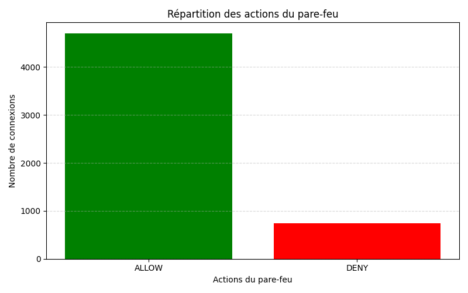
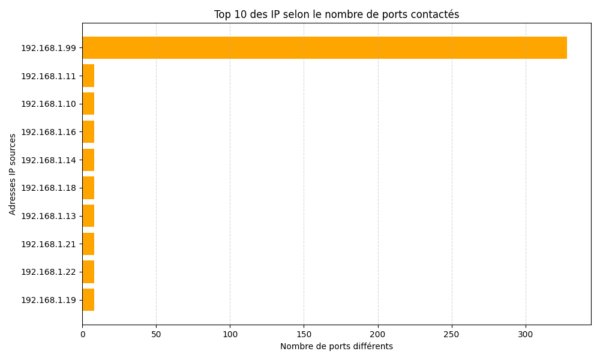
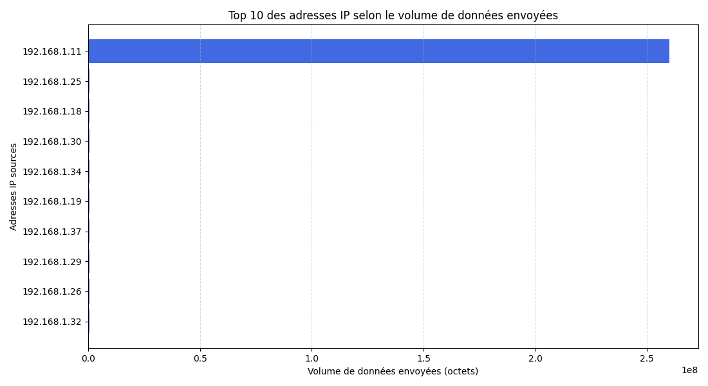

# Rapport d'analyse des journaux d'un pare-feu

**Filière :** Réseaux, Sécurité et Internet des Objets (RSIOT)
**Établissement :** ISEP Amadou Trawaré de Diamniadio
**Étudiante :** Ndioufa Leye

## 1. Introduction

Dans le cadre de notre formation en réseaux et cybersécurité, nous avons réalisé un projet d'analyse des journaux d'un pare-feu à l'aide du langage Python.

L'objectif principal est d'étudier le trafic réseau, d'identifier les comportements suspects et de proposer des recommandations pour améliorer la sécurité d'un réseau d'entreprise.

## 2. Outils utilisés

* Python : traitement et analyse des données.
* Pandas : manipulation et nettoyage des journaux.
* Matplotlib : création des graphiques.
* JupyterLab : développement et expérimentation.
* JSON : enregistrement des résultats.
* GitHub : hébergement et partage du projet.

## 3. Préparation des données

Les données proviennent du fichier `data/logs_reseau.csv`.

Le nettoyage a consisté à :

* Supprimer les doublons exacts.
* Uniformiser les noms des protocoles en majuscules.
* Remplacer les valeurs manquantes de `bytes_sent` par la médiane.

Après nettoyage, le jeu de données contient **5 440 connexions**.

## 4. Analyse du trafic réseau

### 4.1 Protocoles utilisés

L'analyse révèle les résultats suivants :

| Protocole | Nombre de connexions |
| --------- | -------------------: |
| TCP       |                4 526 |
| UDP       |                  760 |
| ICMP      |                  154 |

Le protocole TCP est majoritaire et représente environ 83,2 % des connexions.

### 4.2 Port le plus utilisé

Le port de destination le plus fréquent est le **443**, généralement associé au protocole HTTPS.

### 4.3 Actions du pare-feu

Sur 5 440 connexions :

* 4 702 ont été autorisées.
* 738 ont été refusées.

Le taux de refus est de **13,57 %**.

## 5. Détection des comportements suspects

### 5.1 Activité de scan de ports

L'adresse IP `192.168.1.99` présente un comportement particulièrement suspect :

* 400 connexions générées.
* 328 ports de destination différents contactés.
* 383 connexions refusées.
* 17 connexions autorisées.

Ces résultats suggèrent une activité de reconnaissance ou de scan de ports.

Cependant, cette observation ne permet pas, à elle seule, de confirmer une attaque malveillante.

### 5.2 Analyse des volumes de données

L'adresse IP `192.168.1.11` présente le volume total de données envoyées le plus élevé, soit **259 932 541 octets**, environ 260 Mo.

Ce volume pourrait correspondre à une activité légitime, comme une sauvegarde, ou à un transfert nécessitant une investigation.

Une analyse complémentaire des destinations, des horaires et des flux serait nécessaire pour déterminer s'il existe une éventuelle exfiltration.

## 6. Visualisation des résultats

Trois graphiques ont été réalisés :

**Graphique 1 : Répartition des actions du pare-feu**

Ce graphique permet de comparer les connexions autorisées et refusées.

**Graphique 2 : Détection des scans de ports**

Ce graphique met en évidence l'activité inhabituelle de l'adresse IP `192.168.1.99`.

**Graphique 3 : Volumes de données envoyées**

Ce graphique compare les volumes envoyés par les dix adresses IP sources les plus importantes.

## 7. Recommandations de sécurité

À partir de cette analyse, nous proposons les mesures suivantes :

1. Examiner les connexions provenant de `192.168.1.99` afin de déterminer si elles correspondent à un scan autorisé ou malveillant.
2. Vérifier les services exposés et limiter l'accès aux ports inutiles.
3. Mettre en place une supervision des journaux réseau pour détecter les comportements anormaux.
4. Examiner les transferts effectués par `192.168.1.11`, notamment leurs destinations et leurs horaires.
5. Configurer des alertes en cas de nombreuses connexions refusées ou de tentatives d'accès à plusieurs ports.
6. Mettre régulièrement à jour les règles du pare-feu.

## 8. Conclusion

Ce projet nous a permis d'appliquer les techniques d'analyse de données à la cybersécurité.

Grâce à Python, Pandas et Matplotlib, nous avons nettoyé les journaux, étudié les connexions, identifié des comportements suspects et visualisé les résultats.

L'analyse met notamment en évidence une adresse IP présentant des indices de scan de ports ainsi qu'une autre nécessitant une vérification de ses volumes de transfert.

Ce travail montre l'importance de l'analyse des journaux pour améliorer la surveillance et la sécurité des réseaux informatiques.
